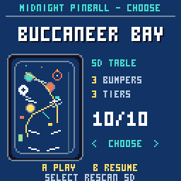
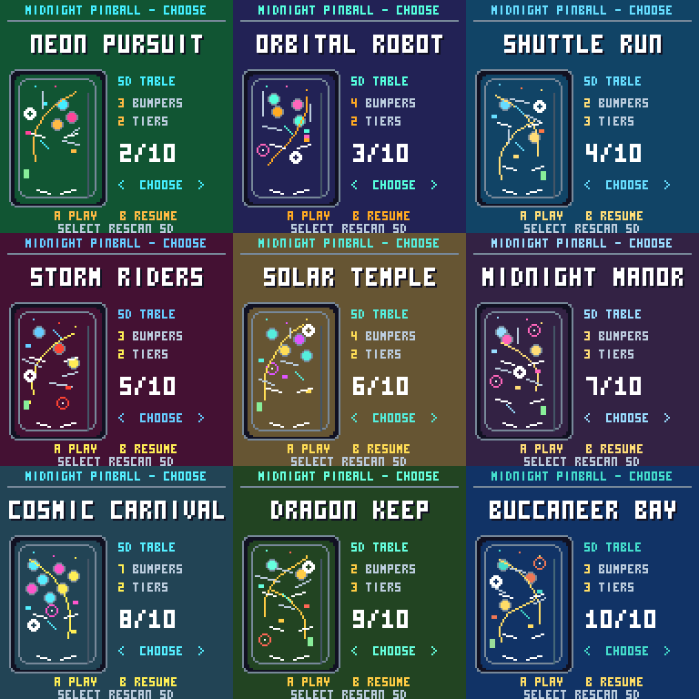
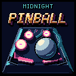
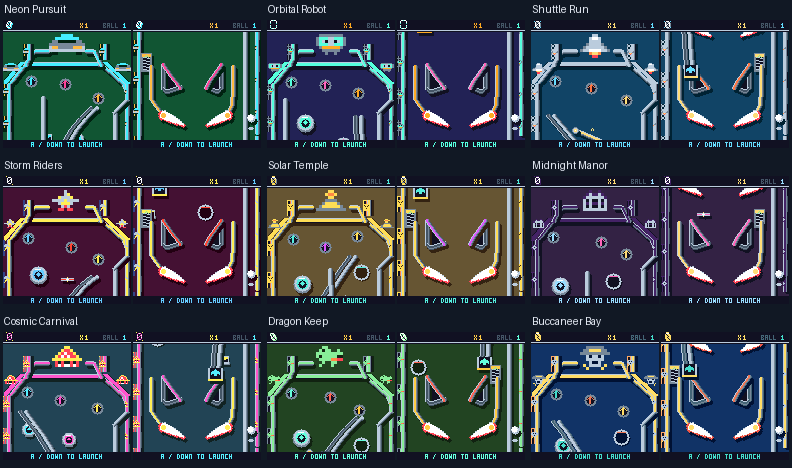
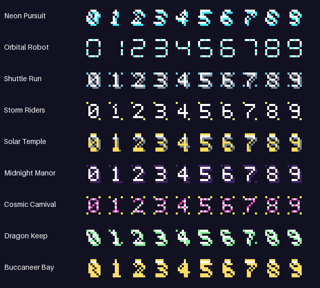

# MIDNIGHT PINBALL

Launch the mode-less browser board editor with `python3 pinball.py editor --open`.
It uses the real C++ game for live play, shares Flipkit's keyboard controls,
and can retrieve, edit, test and save boards over the game's USB connection.
See [Pinball Studio](editor/README.md) for the workflow and [static builds](docs/static-studio.md) for shared firmware/WASM validation and hosting.


An original pinball game for the CHGame Rev0 handheld. Nine tables bring neon
car chases, robots, spaceflight, fighter jets, temples, haunted houses, carnivals,
dragons and pirates to a 128×128 screen. Tables stand 352–432 pixels tall, with
one or two upper flipper pairs and a scrolling camera that follows the action.







The bootloader cover has original gold arcade lettering, a chrome ball and
neon table hardware. Its bumper lamps cycle with the Rainbow bootloader;
the dark apron leaves room for the install progress bar. Regenerate the
128×128, bootloader-palette artwork with `python3 pinball.py boxart`.
The cart exporter includes `docs/cart.png` through `chgame.json`.

| Button | During play |
| --- | --- |
| Left | Left flippers on every tier |
| B | Right flippers on every tier |
| A | Launch while in the shooter lane; shake left during play |
| Right | Shake right during play |
| Down | Tap to shoot at fixed power; holding waits until release |
| START | Pause/resume; hold three seconds for the CHGame menu |
| SELECT | Open the table library and suspend the current game |

In the library, the D-pad chooses a table with a large title and actual-board
thumbnail, plus a large crest in that board’s own theme and felt palette.
Pinball Studio uses the same crests in its board picker, including cloned
and imported boards. A loads and starts a fresh game, B resumes the current one, and
SELECT rescans the SD.
In pause, A or START resumes and B toggles sound. At game over, A or Down
starts again. Pinball stores 96 high scores across two SD journals of 48
scores each. The first journal also stores the sound setting. Each journal
alternates between two checked 512-byte records and verifies writes by
readback. The original 24-score SD journal expands on its first successful
write. Saves from the older flash format require computer-side conversion.
The complete app ID is checked before writing.

Insert the card before starting the game. Prepare a missing save file with
`python3 tools/sd_saves.py prepare --card /path/to/card`; existing journals are
preserved. Saves happen on game over, table changes and sound-setting changes,
outside active ball movement. A write failure reports `SD SAVE FAILED`.

Version 1.4.1 adds PWM rumble on **GPIO1 / PC0 / H1.8**, routed to TIM2
channel 4. Actual flipper contacts, bumpers, slings, launches, ramps,
multiball and drains trigger distinct short pulses. Pause, the library and
board transfers stop the motor. The reusable, nonblocking driver is in
[src/rumble](src/rumble/README.md); each pulse has a 500 ms limit.

One-way gates now have a fixed hinge and stop with a visible swinging arm.
The collision surface follows the same pose as the artwork throughout its
opening and return. An arrow shows the allowed direction; bank locks show
their three target indicators. The gate stays visible when hit.

Every game has three balls. Light all three colors of targets to arm the
reactor, then shoot its scoop for three-ball multiball. Complete the three
rollover lane colors for a higher multiplier (up to 5×) and another ball-save
window. Consecutive lane shots build combos. The scoop starts a double-score
power run, or awards a jackpot during multiball. A short ball-save period
protects fresh launches. Tilt disables the flippers until that ball drains.

The pirate table calls the reactor a cannon, banks treasure, and starts
Treasure Multiball and Broadside scoring. Its sea-blue felt, cannon ramps,
gold banks and animated hardware provide the theme. Background drawings
have been removed: the active mechanisms supply the decoration. All nine
boards have their own colored felt and asymmetric layouts.

Each board now has themed top and side sprites that include the rail faces:
road markings and a car, circuitry and a robot, gantries and a shuttle, storm
clouds and a jet, temple columns and a pyramid, gothic ironwork and a manor,
carnival stripes and a tent, masonry and a dragon, or timber, rope and a pirate
skull. The emblems wrap around the sloping upper rails, on the same felt as
the rest of the board.
The side ornaments remain outside the ball paths and clear of the launcher.

The large top decorations are restored in 1.4.2: each theme has a 36×24 crest
above the roof, connected to the upper rails by shaded supports. The small
corner emblems and side artwork remain. The camera reveals the complete
header near the top, and Studio includes it above the editable playfield.
All transparent areas use the board's own felt; there is no separate panel.



Rounded walls have a thicker shaded body and rubber face. Raised hardware,
the ball and all flippers cast shadows down and right from a shared upper-left
light. Their shadow tint is calculated from each board's felt color, and the
shadows move and zoom with the objects.
Rail sections meet in continuous curved runs. Slingshot rubber compresses on
impact, springs outward and settles; the launcher uses fixed power with no bar.
The left bumper uses the right bumper's body and rubber pixels mirrored,
with a mirrored collision path and board-space shadows. Both lower joints
share the same 15-pixel width.
[Before/after and mirrored right reference](docs/rubber-joint-comparison.gif).
[Six animated ramp-entry comparisons](docs/ramp-entry-alternatives/index.html)
show the current mouth and five narrower profiles with identical ball motion;
they remain previews pending selection.

The larger ball moves at half the original rate. Passive rubber absorbs
energy; flipper contact timing selects the shot angle. Continuous guides
protect every flipper pivot, return lanes feed the main bats, and narrow
outlanes provide a deliberate side drain. A one-way flap prevents returning
to the plunger lane. Three seconds at rest triggers a gentle ball search. During tilt, that
timeout retires the trapped ball instead of repeatedly nudging it; the
normal drain path advances the turn after all active balls are gone.
The gutters continue straight beyond the main pivots: an earlier inward
apron bend could wedge the ball against the right bat. Regression tests
cover both sides, held/released flippers, two incoming speeds and all boards.
Rounded flipper silhouettes supply their own collision spans. Contacts use
the visible pixel edges at each size and pose, with every crossed pose checked
during a fast strike; their shadows remain purely visual.

[Ten animated flipper alternatives](docs/flipper-alternatives/index.html)
compare balanced source outlines through the same pose generator, pivot,
timing and shadows. Design **10, Full curved bat**, is now the active flipper,
with collision masks regenerated from its visible pixels for both sides and
every pose. The earlier design is retained as the comparison reference.

The saucer's steady metal bowl has a lamp showing its next reward: cyan for
2× its configured point value, gold for 3×, then green for its normal point
value plus four seconds of ball save. The scoring multiplier applies to those
points. Each capture advances the lamp; a newly served ball resets the cycle.

### Camera and zoom rules

The camera emphasizes completed objectives and committed shots. Ordinary
rebounds keep the wider view. These are the current rules in `Physics.cpp`;
all zooms peak at **1.5×**, including ramp follow.

| Element or event | Requests a zoom? | Trigger and behavior |
| --- | --- | --- |
| Wall or rail | No | Ordinary passive rebound. |
| Pop bumper | No | Powered hit, points and feedback without camera zoom. |
| Slingshot rubber | No | Rubber flex, kick and feedback without camera zoom. |
| Flipper pair | No | Ordinary or powered flipper contact. |
| Stand-up / drop target | On set completion | The hit that changes the three target-color banks from incomplete to all lit. Individual target hits do not zoom. |
| Rollover lane | On set completion | The hit completing all three lane colors, including at the multiplier cap when the reward is ball save. Individual lanes and combos do not zoom. |
| Scoop | Every accepted capture | Double-score activation, timer refresh, multiball start or jackpot. Refreshing an active mode can still request zoom even though its repeated bonus banner is suppressed. |
| Saucer | Every accepted capture | Each point award or ball-save award requests the same brief zoom. |
| Side ramp, single ball | For the whole ride | Follow the rider across screen boundaries for the complete 90-tick ride, then ease out at the exit. |
| Side ramp, multiball | Brief entry zoom only | Entry requests the ordinary special-hit zoom; continuous ramp follow is disabled while multiple balls are active. |
| Spinner | No | Passage and subsequent spinning awards do not zoom. |
| Kickback | No | Rescue and bonus announcement do not zoom. |
| One-way / bank gate, launcher flap | No | Opening, closing and contact do not zoom. |
| Launch, drain, ball search or shake | No | Shake moves the playfield but does not request a zoom. |
| Score milestone / lucky score | No | The score banner animates independently of the camera. |

Ordinary special-hit requests share a **90-tick (1.5-second) cooldown** across
all balls and elements. A request during that cooldown is ignored. An accepted
request follows the triggering ball, starts a 44-tick envelope (about 0.73 s),
eases in over four ticks, holds, then eases back to 1×. Ramp follow renews that
envelope throughout a single-ball ride, even if entry occurred during cooldown;
on exit it leaves a 17-tick tail for the pullback. Times assume 60 updates/s.

Safety takes priority: if any active ball outside a ramp is within the bottom
85 pixels of the board, zoom is cancelled and the view pulls back faster.
An inactive followed ball or game over also cancels zoom. Normal vertical
scrolling follows the lowest active ball, moving at most six pixels per tick;
the zoom crop follows the selected ball within that viewport. Physics and
input continue throughout, pause freezes the camera, and HUD bars keep their
normal size. Studio's editable full-board view remains unzoomed; its faithful
LCD view uses the same camera rules as the console.

Every board has its own editable 7×9 score digit sprites, almost twice the
old character height. Round milestones and special numbers such as 7,777
and 12,345 trigger a brief expanding score banner at the top of the screen.
It hides while a ball crosses that band and never pauses the solver. Crossing
a number celebrates that milestone without changing the actual score.

Major bonuses also get large, animated two-line announcements in the same
top score-popup band. Their anchor stays fixed throughout multiball; they hide
briefly when a ball crosses that band instead of jumping to the bottom. Multiball
immediately shows `BALL SAVE / 10 SECONDS!`, followed by its multiball banner.
Jackpots, double scoring, multiplier awards, bank completion, saucers and
kickbacks use bouncing entries, themed colors and moving sparkles. The banner
shares space with score milestones and keeps the score HUD intact. Pause
freezes its animation and pending banner.

The lane mini-mission labels its rollover groups A/B/C on the playfield.
Missing lamps pulse; collected lamps stay lit, and the footer and Studio
keep the set's progress and next multiplier visible. The launch tutorial
and unique lane hits show the remaining **actual lane sprites**, their letters
and the next reward in the large bonus banner. Repeated hits do not restart
that reminder. Custom drafts without all three groups hide the mission.
Other bonus banners show the corresponding playfield sprite too: in
particular, **SHOOT SCOOP!** includes the scoop in its own board group color.
Icons stay in screen space during camera zooms. Font rows and flipper
collision spans are stored losslessly to fit this UI without removing art;
the latter still represent exactly the visible rubber pixels and tiny gaps.

Double-score banners and their short announcement appear only when a new
scoring window starts. A scoop hit during an active window still refreshes
the timer and earns its points, without restarting or queuing the same banner.
After the window expires, a newly earned one is announced normally. New
awards such as jackpots and multiball keep their own celebrations.

The [captured messages page](docs/popups/index.html) preserves all popup states, score values and animations in nine themes. It works as a standalone static page.

Popup text and target sprites keep clear of their panel outlines. The score
caption has its own row with three blank pixels below it. Regenerate the
complete captured gallery with `python3 Pinball/tools/preview_popups.py`, then
`python3 Pinball/tools/preview_popups.py --publish-only` to update the preserved page, or
run its `--check-layout` option for the same text, icon-gap and score-padding
checks across every theme and sampled animation frame without writing images.

The HUD and Studio show the effective score multiplier: the lane multiplier
(1–5) combined with any active double-score mode (up to ×10). Multiplier bonus
announcements use that same value, matching the points actually awarded.



## Build and play

Builds run the [automatic regression gates](docs/regression-testing.md), including
seeded synthetic play with rendering and drawing-work budgets. Uploads also
require the real console's render and physics clocks to remain near 60 Hz.

Use the workspace's [setup](../README.md#setup) first. From the repository root:

```sh
python3 pinball.py boards --image Pinball/out/pinball.img
python3 pinball.py build
python3 pinball.py export --no-build
python3 pinball.py cart verify Pinball/build/Pinball.chgame
python3 pinball.py run tools/scripts/preview.txt out/preview --card Pinball/out/pinball.img
.venv/bin/python Pinball/tools/verify_sim.py
.venv/bin/python Pinball/tools/verify_flippers.py
.venv/bin/python Pinball/tools/preview.py
.venv/bin/python Pinball/tools/preview_borders.py
.venv/bin/python Pinball/tools/sprites.py --check
.venv/bin/python Pinball/tools/evaluate_boards.py --seeds 6 --seconds 120
python3 Pinball/tools/benchmark_scatter.py --check
python3 Pinball/tools/benchmark_spin.py --check
```

`build/release/Pinball.ino.bin` is the firmware. `build/Pinball.chgame` bundles
the firmware, all nine SD tables, and the theme art pack, so CHGame cart
deployment can install them together. To install manually, copy the `sd/PINBALL` folder to the root of a
FAT16/FAT32 SD card. The console loads every board from SD, including Neon
Pursuit. Studio includes the default boards for browser play.

When ready to replace the currently running handheld application:

```sh
python3 pinball.py upload
```

The simulator checks and seeded autoplay run locally; no paid CI is needed.
The [scatter benchmark](docs/physics-scatter.md#repeatable-gameplay-benchmark)
compares real rebounds and paired board sessions against a saved baseline.
It reports displacement, route changes, drains, scoring and per-board uncertainty.
The optional [contact-spin experiment](docs/physics-spin.md) compares persistent
rotation, several grip strengths and powered-scatter hybrids using the same
synthetic players; production defaults keep spin disabled.
`tools/verify_device.py --port /dev/cu.usbmodem101` checks a debug build on
the physical CHGame with USB-injected button inputs and records timing,
stack use, framebuffer captures and SD board loading. Physical button feel
and enjoyment still require human playtesting.
See the [device validation record](docs/device-validation.md) for measured results.

## SD table library

| File | Table | Height |
| --- | --- | --- |
| NEON.PBT | Neon Pursuit | 384 |
| ORBITRON.PBT | Orbital Robot | 400 |
| SHUTTLE.PBT | Shuttle Run | 416 |
| STORM.PBT | Storm Riders | 352 |
| SOLAR.PBT | Solar Temple | 384 |
| MIDNIGHT.PBT | Midnight Manor | 432 |
| CARNIVAL.PBT | Cosmic Carnival | 352 |
| DRAGON.PBT | Dragon Keep | 416 |
| PIRATES.PBT | Buccaneer Bay | 432 |

The browser finds `.PBT` files in the card root and in `/PINBALL`, using FAT
8.3 short names. The console picker holds up to 96 SD entries. It
loads a table when chosen, without reflashing or rebooting, and keeps its
geometry in RAM throughout play. There is no per-frame SD traffic. Return to
the library and press SELECT after adding files or changing cards.
An empty or unreadable card shows its status in the picker. Insert a card
with valid boards and press SELECT to rescan.

`/PINBALL/THEMES.PBA` contains the eight additional themes' side rails, crests,
and score digits. The console reads the selected theme when browsing or
switching boards and keeps one theme in RAM. Neon Pursuit and the shared roof
trim are built in, so a missing, unreadable, or corrupt theme falls back to
Neon art with the selected board's palette. Layouts and scoring still work.
Studio embeds all nine themes for browser play.

Reads wait for LCD DMA because the display and SD card share SPI. Loading
re-mounts the card and finds the selected name again, so stale cluster numbers
cannot be used after swapping cards. The file is read into a staging table;
its signature, version, complete length, checksum, palette, dimensions,
geometry and required scoring elements are checked before replacing the
running table. An invalid file, a missing card, or a read failure leaves the
previous table and game intact. Eight file extents are supported; copying a
highly fragmented file afresh can reduce its extent count. exFAT is unsupported.

## Make more boards

Edit [`boards/tables.json`](boards/tables.json), then run `python3 pinball.py
boards`. Every entry has a unique `file` (uppercase 8-character stem), stable
32-bit `id`, title, mission, theme (0–8), height (256–480), gravity (8–44,
Q8 pixels/frame²), 16 RGB444 palette colors, and up to 72 objects.

The reusable [element library](elements/README.md) documents twelve kinds,
their behaviors, geometry, state machines and editable animation frames.
Combine side ramps, spinners, drop targets, directional gates, saucers,
kickbacks, pop bumpers, lanes, scoops, rails and extra flipper pairs. Layout
and palette edits load from SD; edit `sprites/element_sprites.json` and run
`tools/sprites.py` to change the artwork in the firmware. The compiler
requires target and lane groups 0, 1 and 2, plus a scoop. Stable table IDs
retain high scores when filenames change.

PBT1 files use a 96-byte little-endian header followed by 12-byte object
records, with the exact layout in `Table.h`. The checksum is FNV-1a over the
whole file with header bytes 16–19 treated as zero. Each shipped table takes
under 512 bytes. `python3 pinball.py boards --check` verifies generated files
against their source without changing them.

## Validation and design references

The [seeded playability report](docs/playability.md) compares normal-input
controllers across all boards, measuring flow, shot diversity, progression,
stalls, recovery nudges and readable speed. Its score is a design proxy,
not a measurement of human enjoyment. Warnings stay visible for further
board tuning and human playtests. See the element library for the method.

Return lanes and protected pivots follow the construction visible in
[Stern's playfield assembly drawing](https://sternpinball.com/wp-content/uploads/2020/12/StarWars_Pin_web.pdf)
(page 23); narrow outlanes and a kickback also appear in the
[Williams High Speed chart](https://www.pinballrebel.com/pinball/cards/Tech_Charts/Williams_High_Speed_Tech_Chart.pdf).

The test drives the actual sketch and FAT code with real FAT16/FAT32 images.
It checks all tables, both flippers, both launch buttons, scrolling, pause,
ball save, tilt, multiball, card removal/reinsertion, failed loads, and long
play with changing inputs. An independent pixel sampler checks all zoom
scales against the in-place framebuffer transform and verifies the HUD.
UBSan and bounds checks cover the pinball code; `tools/sanitizer.ignore`
documents narrow exclusions in the pinned upstream library. On a host
with a working AddressSanitizer runtime, add
`PINBALL_SANITIZERS=address,undefined,bounds` when running the verifier.

The multi-screen idea draws from Pokémon Pinball, Kirby's Pinball Land and
Revenge of the 'Gator ([handheld pinball review roundup](https://www.nintendolife.com/guides/best-nintendo-pinball-games)).
The original color and theme treatments recall High Speed, Pin-Bot, Space
Shuttle, F-14 Tomcat, Pharaoh, Haunted House, Comet and Black Knight. The
pirate addition also recalls [Bally's Black Rose](https://flyers.arcade-museum.com/pinballs/show/7077)
(1992). The game uses original geometry and pixel motifs.

## Progressive shake

A and Right shove the cabinet left and right. The free ball receives the
opposite lateral impulse, without changing gravity. Like Flipkit's Tab shake,
fresh taps within 420 ms build three levels and restart a damped
700 ms cabinet wobble. Their force, rumble and visual amplitudes match the old
levels 1, 3 and 5: level 3 retains the previous maximum. Held buttons count
once. Level 3 shows DANGER; a fourth rapid tap causes TILT.
Flippers, powered saves and scoring are disabled
until all balls drain. The next ball resets the mechanism. Shaking also gives
a short progressive rumble pulse on GPIO1/PC0. A still launches before play;
Down always serves as the launcher. The score and warning strip stay steady.

`tools/verify_shake.py` checks input edges, inertia, timing, tilt, drain reset,
paused state and pixel-exact playfield shifts against the real native engine.
It also verifies all 90 score glyphs after lossless flash packing.

Version 1.4.5 makes each shove easier to read: the first tap now moves the
board by up to three pixels, rising to six at maximum strength. Two brief
edge pulses and directional chevrons mark the impact. A larger five-segment
footer shows strength and direction, turning orange at level 4 and red at
level 5. Tilt keeps its red warning until drain. These are visual changes;
ball inertia, gravity, timing and the six-tap tilt threshold are unchanged.

For a cart update without mounting the SD drive, while Pinball is running:

This procedure replaces the menu cart only. On the first update to a build
that loads theme art from SD, also copy `sd/PINBALL/THEMES.PBA` into the card's
`/PINBALL` folder using a card reader.

```sh
python3 pinball.py build
python3 pinball.py export --no-build
python3 pinball.py uploader flash Pinball/build/release/Pinball.ino.bin --port /dev/cu.usbmodem101 --run
.venv/bin/python Pinball/tools/update_cart_live.py --port /dev/cu.usbmodem101 --destination GAMES/MYGAMESP/MIDNIGHT.CHG
```

Pass the existing cart's path under `GAMES/`; the default is
`GAMES/MIDNIGHT.CHG`. This replaces that cart in place, preserving the menu's
folder organization. The host allocates a new FAT chain, verifies it before
publication, then releases the old cart chain. It compares every other game
and board file before and after, and checks all nine originals and both test
boards. The installed game must match the package version. This does not
install a bootloader or a mass-storage driver.

Version 1.4.8 restores the real timer output for its direct beeps when no indexed effect table is registered. Pinball retains its event-driven sound effects; this update adds no background soundtrack. See [the audio comparison notes](../docs/audio-improvements.md).

Version 1.4.9 adds [small seeded impact scatter](docs/physics-scatter.md). Firm
rebounds and ejects vary slightly while remaining reproducible from a seed.
