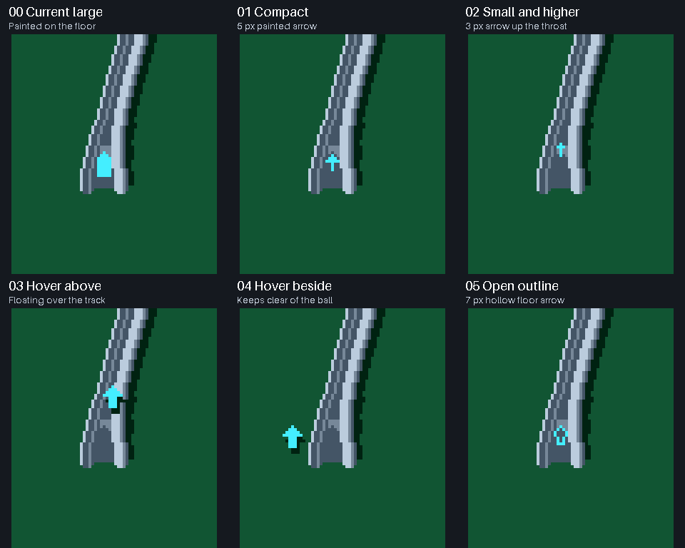

# Arrow treatments on entrance 04

The game now uses the short-funnel entrance selected as **04** in the width
comparison. These separate arrow numbers compare the existing arrow with five
alternatives. The selected game treatment now hovers inside the mouth at the
marked location, one native pixel to the left, and stays above the passing
ball. [Reviewed shift and applied animation](../ramp-arrow-shift/applied.gif).

| Arrow | Treatment |
| --- | --- |
| 00 | Existing large arrow painted on the floor |
| 01 | Compact 5-pixel floor arrow |
| 02 | Small 3-pixel arrow higher in the throat |
| 03 | A larger hovering arrow above the entrance |
| 04 | A hovering arrow beside the entrance, clear of the ball's path |
| 05 | Hollow outline instead of a solid arrow |

`tools/preview_ramp_arrows.py` compiles actual C++ renderer and sprite snapshots,
using the existing editable sprite stencil and packer. All six variants use
identical physics, seed and ball motion, verified by their complete captured
position/velocity traces. The camera is fixed for review. Each clip shows
30 frames without a shot, then an upward shot and the full ramp ride at 60 Hz.
The ball retains its foreground layer when it is on the ramp, including with
hover markers.

This gallery preserves the earlier candidate comparison. The selected mouth
arrow is stored as editable ramp sprite frame 1, with its own board-tinted
shadow; frame 0 supplies the entrance surface. Browser drag previews and
toolbox art include the same arrow.
