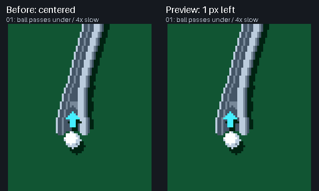
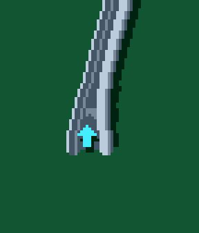

# Selected floating ramp arrow

The selected behavior is **01: the ball passes underneath the arrow**. The
marker sits at the marked mouth position, shifted one native pixel left
(anchor offsets −1, +4 relative to the ramp entrance). Its slight vertical
hover remains unchanged.

`applied-validation.json` records an exact comparison of 150 framebuffer
captures from the actual updated game against the reviewed proposal. The
floating marker draws after riding balls; ordinary elevated rails still draw
over ground-level balls and flippers, and underneath ramp riders.
