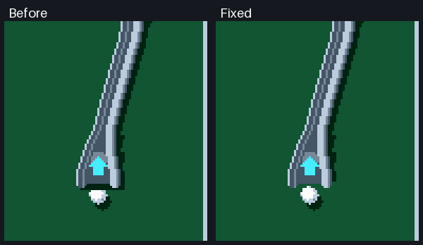

# Ramp entrance review

`00` retains the previous wide entrance; `01`–`05` are visual alternatives,
with identical physics and ball motion. **04 Short funnel is now selected**
for the game. [Arrow treatments](../ramp-arrow-alternatives/index.html) compare
the current arrow and five possible replacements on that selected profile.

The corrected previews remove the transverse cast-shadow strip across the
open mouth. The shared deck renderer retains shadows beneath the raised track;
the entrance sprite no longer duplicates that shadow.

Capture now starts when the upward-moving ball's leading edge reaches the
lower lip, eight board pixels below the ramp anchor. The exact contact position
is retained. An eight-frame approach brings the ball through the throat before
it follows the elevated curve. The complete ride still lasts 90 frames and
reaches the configured exit with camera follow throughout.

The left-hand capture comes from commit `ed7c67b`; the right-hand capture uses
the corrected engine. Both use the actual C++ renderer and solver with a fixed
camera, not a separate animation of the ball.

The canonical `tools/build_studio.py --build-firmware` gate includes 27 entrance
shots across three ramp curves, three mouth positions and three speeds. It
checks perimeter capture, every visible ball pixel during entry, displacement
through the throat, full-length transport, rejected side/downward shots and the
absence of a dark strip below the lip. Repeated synthetic games, native/WASM
parity, camera tests and drawing budgets run in the same gate.

Regenerate the six width previews with `tools/preview_ramp_entries.py`.
