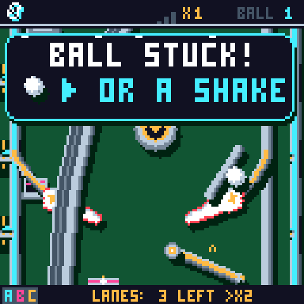

# Stuck-ball shake help

After 90 stationary physics frames (1.5 seconds), the LCD shows a large
**BALL STUCK!** panel with **▶ OR A SHAKE**. The filled right triangle appears
before A, matching the console controls. It uses the same large type and panel
as the bonus announcements.

The message clears when the ball escapes a fixed two-pixel tolerance around
its resting position, or when the player shakes. Subpixel rebound jitter is
counted as stationary, including repeated crossings of pixel boundaries.
Holding the flippers does not hide a ball stuck elsewhere. Slow rolling leaves
this fixed area and resets detection, so creeping balls do not trigger the
message. During multiball, one moving ball does not dismiss help for another
stationary ball.

Launcher balls, ramp transport, scoop/saucer holds, pause and tilt do not show
the prompt. The full-board editor omits the LCD banner and preserves the live
state. Normal stuck handling is informational: it never kicks or drains the
ball, starts a new turn, or switches screens. During tilt, when shaking is
disabled, a ball trapped for three seconds is retired to avoid locking play.

The post-build regression gate checks timing, both controls, slow movement in
three directions, held flippers, pause, multiball, long-lived warning stability, tilt recovery,
full-board/LCD restoration and every pixel of the solid control triangle.
The popup gallery includes the help panel in all nine themes.
