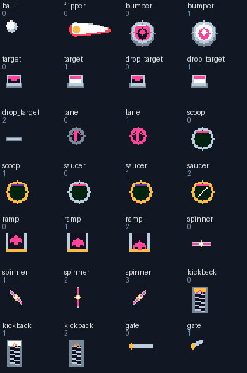

# Pinball element library

`Elements.h/.cpp` describes the reusable parts and shared ramp/guide geometry.
`Physics.cpp` implements their state machines; `Render.cpp` selects animation
frames from `sprites/element_sprites.json`. Tables combine parts in
`boards/tables.json`. Geometry and rules belong to a table; art belongs to a
sprite, with colors supplied by each table's RGB444 palette.



| Kind | Parameters | Behavior | Sprite frames |
| --- | --- | --- | --- |
| `wall` | x,y to u,v | Solid rail, restitution 0.5 | Five-pixel rounded body, rubber crown, lit shoulder and cast shadow |
| `bumper` | center x,y; u radius; v powered impulse in Q8 | Radial rebound, score, impact cooldown | `bumper`: idle / flash |
| `target` | center x,y; u width; v thickness in quarter pixels | Stand-up target lights group 0, 1 or 2 | `target`: unlit / lit |
| `lane` | center x,y; u trigger radius | Rollover combos; three colors raise multiplier, grant ball save and rearm kickbacks | `lane`: unlit / lit |
| `scoop` | center x,y; u capture radius; mouth faces down | Upward front entry; solid hood back/shoulders; 30-frame hold beneath the board; double scoring, three-bank multiball or jackpot; eject through the same mouth toward open field | `scoop`: metal hood, shaded opening, idle / armed indicator; ball sinks behind the hood then visibly emerges before release |
| `flippers` | x left pivot; u right pivot; y pivot row; v length | Left/B drive tapered bats, timing changes shot angle; continuous side guides protect pivots | `flipper`: one editable bat generates nine stroke poses per side at build time |
| `ramp` | entrance x,y; exit u,v; group 0 left curve, 1 right curve, 2 central curve | Upward approach enters an elevated track; 90-frame Bezier ride; controlled return feed | `ramp`: static shaded entry pan / large upward arrow; opaque deck and continuous rails follow the shared path; deck hides hardware below, rider stays above |
| `spinner` | center x,y; u culling extent (6-16) | Seven-pixel pass-through trigger; spins 72 frames, awards points every 12 frames | `spinner`: four rotor angles |
| `drop_target` | same geometry as target | Falls on hit; ceases collision while down; resets on new ball or multiball | `drop_target`: up / falling / down |
| `kickback` | center x,y; u trigger radius | One-shot outlane rescue; lane set rearms | `kickback`: armed / firing / spent |
| `gate` | x,y to u,v; group 0 permits up, 1 permits down, 2 opens after all target colors | Directional flap or bank-controlled barrier | `gate`: shut / open, plus solid rail when shut |
| `rubber` | outer top x,y; u width (8–24), v height (16–40); group 0 points right, 1 points left | Powered slingshot face, solid metal base; 18-frame compression/recoil, separate state per part; scoring disabled by tilt | Procedural thick base, board-tinted shadow and flexing band share the same scaled geometry with collision |
| `saucer` | center x,y; u capture radius | 60-frame hold, escalating three-step award, ball save every third hit, controlled eject | `saucer`: steady metal bowl; cyan lamp for 2× value, gold for 3×, green for normal value plus four seconds of ball save |

All kinds use `value` as the base score (0-10000), and most use `group` to
select cyan, pink or gold. Powered and trigger elements have independent
cooldowns. Captured balls leave beyond the cup lip, with a four-second cup
cooldown, so they cannot repeatedly collect a cup while still inside it.

Slingshots are movable table objects: select either rubber triangle in Studio
to move, resize, mirror, duplicate, remove or change its score. Add more using
**Rubber slingshot** in the parts bin. The outer top corner is the placement
anchor. Width and height include the base; rail thickness is retained when
resizing. The curved band and the solid back/bottom contacts move together.

PBT1 header flag bit 0 means the board explicitly lists its rubbers, including
an intentionally empty list. Kind 12 is `rubber`. Old flag-zero boards keep
the original fixed pair on the console; Studio materializes that pair as
editable objects on opening/import without changing their layout. Exports
retain the flag so deleting both never brings back invisible cabinet rubbers.
The explicit parts count toward the 72-element limit. A completely full legacy
board needs two other parts removed before its converted draft can be saved.
Other flag bits are rejected. New-format layouts need a firmware build with
editable-rubber support; older firmware rejects them safely.

The shared lower assembly includes a plunger, one-way shooter
flap, main flippers, return lanes and narrow outlanes. Outlane rail centers
are 12 pixels apart for the eight-pixel collision diameter. Inlane guides
continue into each pivot; upper pairs have continuous side guides too.
The renderer and solver both use `flipperGuides()`, preventing visual rails
from disagreeing with their collision geometry. The player can nudge with
Up. A ball resting for three seconds receives a small automatic ball-search
impulse; holds, ramps, the shooter and held flippers are excluded.

## Edit the art

Edit the rectangular ASCII frames in `sprites/element_sprites.json`.
Rows are pixels; animation frames share dimensions and can be at most 32x32.
The flipper's pivot and stroke angles are in `sprites/flipper.json` (currently
pixel (6,6)); its long axis points right in the source. Its rounded taper,
every pose and its unshadowed collision spans regenerate from the same art.

| Ink | Meaning |
| --- | --- |
| `.` | Transparent |
| `0` | Dark cavity (palette 2) |
| `w` | White ball / highlights (1) |
| `m`, `s` | Metal / silver (3,14) |
| `t` | Cyan (4) |
| `d` | Dark panel (7) |
| `i` | Muted metal / shaded ramp surface (5) |
| `c` | Per-object group color (remapped from 8) |
| `o`, `g` | Orange / gold (9,10) |
| `b`, `p`, `r` | Blue / purple / red (12,13,6) |

Run `.venv/bin/python Pinball/tools/sprites.py` to regenerate `SpriteData.h`,
`FlipperData.h`, `ScoreData.h` and `BorderData.h`, then rebuild the cart. `--check` detects stale generated art. Sprite changes
apply to the library globally; table palettes and layouts load from SD.
Sprite data is compiled into flash, so editing art requires a firmware/cart
rebuild. Layout and palette edits only require rebuilding/copying `.PBT` files.

The large white ball has a separate nine-pixel sprite. Felt uses palette 0,
independently of the dark cavities and HUD. Keep the felt darker than active
parts and reserve white highlights for the ball and rubber.

Lighting comes from the upper left. Palette 2 is a shadow shade derived from
the felt: each RGB444 channel is halved when a board loads, including custom
SD palettes. It also colors recessed cup interiors. Walls have rounded ends,
a five-pixel shaded body and a three-pixel contact crown; the existing collision
and narrow-lane clearances are retained. `sprites/shadows.json` sets the cast
offset for each raised sprite, including the ball and every flipper pose.
Shadows are baked behind the editable art with its original anchor preserved,
so they follow rotation, scrolling and zoom without extra sprite passes.
Rollovers remain flush with the felt. Regenerate with `tools/sprites.py`.

`sprites/board_borders.json` provides a top cap (128×34), side sprite
(11×16) and editable emblem (12×8) for every theme, using the same ink legend.
The top cap follows both upper corners and the roof rail at world (0,0).
Each emblem is rendered as a large 36×24 crest at world (46,-22), with
shaded supports joining the roof. Smaller copies still occupy the outside
rail cheeks. The camera can reach y=-24 to reveal the full crest. Studio
uses the same renderer for this header, above its editable world origin.
Transparent pixels expose the board's felt, without a separate panel.
The generator trims the top cap's empty rows and stores it at world y=6;
the editable 128×34 source keeps its original coordinates.
The side sprite includes the rail centered on column 6, its shaded foot and
its cast shadow. It tiles at world y=28+32n on the left; the right rail uses
only columns 4–9, leaving the plunger lane unobstructed.

Identical sprite parts are stored once in flash. Border art is visual only: it
never supplies new collision geometry. The rail's contact crown and ball
paths must remain readable when editing a skin. `tools/preview_borders.py`
renders both ends of every actual board to `docs/borders.png` for review.

Connected rails draw as complete runs: their full shadows precede the metal,
internal end caps are omitted and bends receive short curved transitions.
Ramp rails use the shared Bezier path with sixteen sections and no joint marks.
The opaque ramp floor uses the SRAM beam walker and horizontal spans, rather
than many overlapping `gfx_line` calls. Rendering and physics currently share
the 60 Hz frame loop, so device timing is a required check for rendering changes:

```sh
python3 Pinball/tools/verify_device_fps.py --port /dev/cu.usbmodem101 --out Pinball/out/device/fps.json
```

This runs RAM-only current/empty and one/two-ramp fixtures, checks both render
and physics rates, then restores and restarts the current table. It does not
write SD boards or save data. The default minimum is 57 Hz to allow measurement
jitter around the 60 Hz target.

The slingshot bands compress at impact, recoil outward and damp back to rest
over eighteen frames; their collision segments follow the same flexed curve.
The plunger launches at fixed power, so its head has no force meter.

Flipper collisions measure the ball against the actual opaque pixel spans,
including the renderer's integer scaling and anchor rounding on upper bats.
The art-derived hull supplies an escape direction when a fast stroke overlaps
a ball center; the final contact is resolved against the visible pixels.
Every crossed pose is checked during a fast stroke. Cast shadows never collide.
`tools/verify_flippers.py` compares the real solver with independently rasterized
art on both sides, all nine stroke poses and all eleven allowed SD bat sizes,
checking near misses, visible overlaps, base/tip contacts and fast strokes.

Score art is in `sprites/score_digits.json`: ten editable 7×9 ASCII digits
for each of the nine board themes, using the same ink legend. The board's
`theme` selects its digit set. `docs/score-styles.png` shows the source art.
The generated font uses two bits per pixel and up to four inks per theme,
including transparency, preserving the editable source pixels exactly.
The regular HUD uses these larger sprites; milestone popups scale the same
glyphs with a short overshoot and a 120-frame celebration cooldown. The
popup lasts 36 frames, including two setup frames that let the changed HUD
transfer first. It chooses the clearer screen band and yields to active balls.

Ramps retain the normal 1.5× special-hit zoom, but hold their camera state
through the full 90-frame ride. The 44-frame special-hit timer is refreshed
while riding; at the exact exit it holds the final view and then eases out.
During multiball the camera prioritizes the free balls and drain visibility.

The main gutters must keep their outer rails vertical past the flipper
pivots. An inward apron diagonal previously pinched the eight-pixel ball
against the right bat. The regression suite places balls at the photographed
pocket and nearby positions across all nine boards: 180 held/released and
stationary/descending cases must drain with no automatic search or nudge.

## Combine parts into a board

Use an existing JSON board as a template and give it a unique stable `id`
and an uppercase FAT 8.3 filename stem. Add at least one scoop and all three
target and rollover colors. Use different shot entrances, exits, upper
flipper rows and banks, rather than recoloring the same arrangement.

Leave clearance for an eight-pixel ball plus rail thickness. Connect rails
cleanly to side walls, slope closed gates so a resting ball can roll off,
and avoid small pockets between an element and a flipper guide. A raised
ramp is solid only at its entrance: its track carries a captured ball over
other components; balls underneath may pass the elevated rails. Its entrance
sprite is a static shaded metal pan with a large upward arrow. Its flared
rails narrow continuously into the curved track; shoot into the open mouth
from below, rather than at the upper end.

`python3 pinball.py boards --image Pinball/out/pinball.img` compiles and
validates PBT files. `.venv/bin/python Pinball/tools/verify_sim.py` checks
behaviors, return-lane feeds, outlanes, shooter exclusion and damping, in
addition to FAT loading, malformed files, multiball and camera transforms.

## Automated playability assessment

Run `.venv/bin/python Pinball/tools/evaluate_boards.py --seeds 6 --seconds 120`.
It plays every board using the actual solver and normal inputs, comparing
no flippers, random flipping and a reactive player with varied shot timing
and legal nudges. It does not place balls, force collisions or award scores.
Reports are saved to `docs/playability.json` and `docs/playability.md`.

It records survival (censored at the time limit), scores, explored cells,
element variety, flipper strikes, ramps, spins, dropped targets, kickbacks,
lanes, bank sets, multiballs, automatic searches, player nudges, long stalls,
scoring droughts, route novelty and fast motion. The hand-weighted proxy
rewards variety, timing advantage, progression, flow and readability. Cup
farming is capped as progression; a high score does not suppress warnings.

This is a repeatable design diagnostic, not a validated rating of human
fun. A weak controller can miss a good shot, and a good proxy can still feel
boring. Use the flags to choose what to inspect and compare changes under
the same seeds, then play on the handheld for button feel, clarity and fun.

### Editable-rubber regression coverage

Studio model checks cover idempotent legacy conversion, empty-rubber round trips,
picking the triangular footprint, dimensions, mirroring and the 72-part limit.
The native/WASM replay checks default trajectories, moved powered contacts,
resizing, live removal and the absence of ghost colliders. Native image checks
compare implicit and editable defaults through all nineteen flex poses. An
algebraic Bezier reduction is checked against the old geometry at every Q8
sample, for both hands and seven bend levels.

To fit the new element in the console cart, flippers share mirrored collision
masks and store their already-converted hull corners. The generator verifies
every mirrored span; traversal preserves the original tie order and scaling.
The unchanged 4,798-probe art/collision check remains part of each build.
The pre-packing WASM engine also matched the new native build across 5,645 ticks,
116 live edits and 373 complete state/LCD/overview snapshots. Card error labels
were shortened while retaining their meaning. No physics constants changed.
