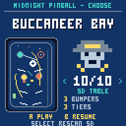
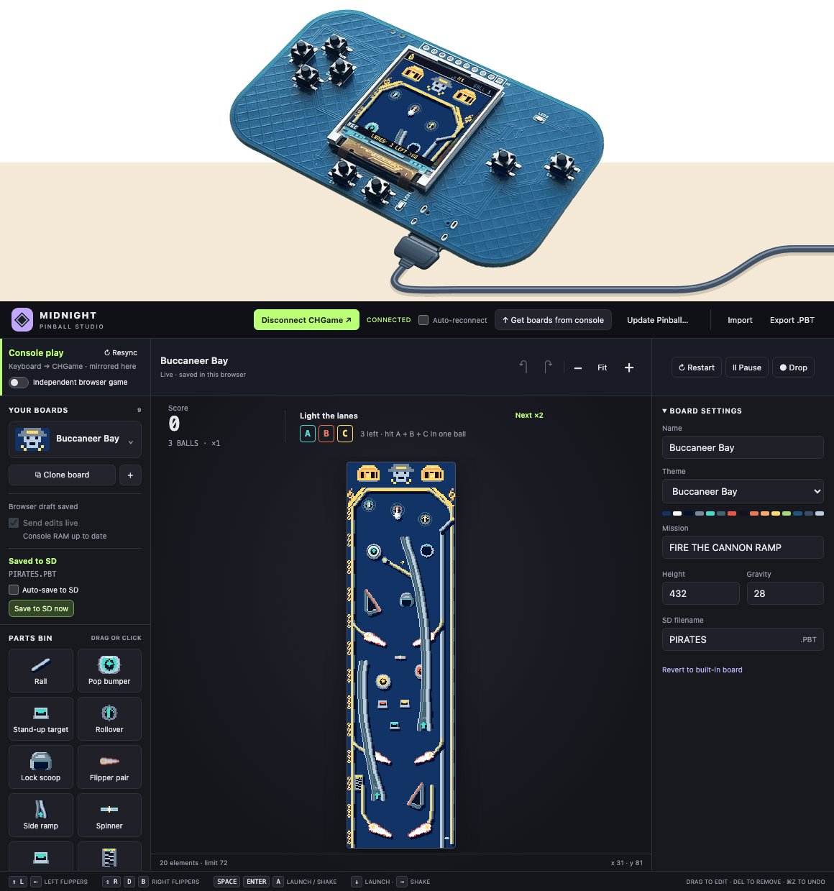

# Midnight Pinball for CHGame

Play nine original pinball tables on [Kevin Bates’s CHGame color game console](https://github.com/bateske/CHGame). The tables load from SD and scroll across several screens, with upper flippers, ramps, and multiball.



Open [Pinball Studio](https://juliendorra.com/chgame-pinball/) in desktop Chrome or Edge and select **Connect CHGame**. Studio connects directly if Pinball is already running. If the current cart is on the SD card, Studio launches Pinball on the console automatically. If the cart is missing or out of date, Studio offers to install or update it and then launch it.

**[Download the .chgame console cart](https://github.com/juliendorra/chgame-pinball/releases/latest)**

You can also launch **MIDNIGHT PINBALL** from the CHGame menu. Pick a table with the D-pad and press **A** to start.

| CHGame button | During play |
| --- | --- |
| Left / B | Left / right flippers |
| Down | Launch |
| A | Launch in the shooter lane or shake during play |
| Right | Shake during play |
| START | Pause or resume |
| SELECT | Open the table library |

See the [full gameplay guide](Pinball/README.md) for table rules, scoring, and saves.

## Edit while you play in Pinball Studio

**[Open Pinball Studio](https://juliendorra.com/chgame-pinball/)**

Move parts or add new ones while the ball keeps moving. Clone a table to try a different layout, or build a new one. Studio runs the same C++ physics, rules, and renderer as the handheld.



Studio sends the edit to the CHGame simulator over the live protocol. The clip combines the simulated LCD, an illustrated USB-C cable, and the [Rev0 board photo from the CHGame site](https://github.com/bateske/CHGame/blob/e1f8d05940ddb7bbef89c13326da75c003f02904/docs/brand/board.webp).

Connect a CHGame over USB in desktop Chrome or Edge to retrieve tables, try live edits on the console, or save boards to its SD card. Console Play mirrors the handheld in the browser. Turn on **Independent browser game** to keep a separate browser game while you edit.

See the [Studio guide](Pinball/editor/README.md) and [shared build guarantees](Pinball/docs/static-studio.md). The [latest release](https://github.com/juliendorra/chgame-pinball/releases/latest) also includes the matching offline editor.

## Build the editor

Install Python 3.12+, Node.js 22 and Clang, then:

```sh
git clone https://github.com/juliendorra/chgame-pinball.git
cd chgame-pinball
python3 -m venv .venv
.venv/bin/python -m pip install -r requirements.txt
git clone https://github.com/emscripten-core/emsdk.git .toolchains/pinball-emsdk
python3 .toolchains/pinball-emsdk/emsdk.py install 4.0.15
python3 .toolchains/pinball-emsdk/emsdk.py activate 4.0.15
python3 pinball.py web
python3 pinball.py editor --no-build --open
```

The build runs native/WASM state and pixel parity, editor tests, independent FAT readback tests, sanitized physics regressions and repeated synthetic play. Only a validated bundle is published to `Pinball/build/studio/`. A freshness manifest records game inputs and artifact hashes. No generated build files or proprietary Game Boy ROMs are included in this repository.

## Firmware

Install `uv` and Arduino CLI, then run `python3 pinball.py setup`. On Apple silicon, this also builds the native RISC-V compiler; see [toolchain requirements](tools/toolchain/CURRENT-GCC.md). `python3 pinball.py build` builds firmware and its matching validated editor. `python3 pinball.py upload` builds and installs on a connected CHGame.

## Publishing

[The deployment guide](docs/deployment.md) describes OVH directory scoping, repository secrets and the site-only deployment trigger.

## Credits and dependencies

- **CHGame SDK and libraries.** Kevin Bates (bateske) and the [CHGame contributors](https://github.com/bateske/CHGame) provide the Arduino board package, game loop, input, and audio APIs. CHGfx supplies the framebuffer, palette, and drawing code shared by firmware and Studio. The bundled libraries include Press Play On Tape’s 3×5 font and Adafruit Industries’ 5×7 GLCD font. The board package and USB bootloader build on CH32SerialBoot, jobitjoseph’s Arduino core and USB Serial work, and WCH’s CH32 core. See the [bundled SDK revision and local changes](CHGame/VENDOR.json), [CHGame library notice](CHGame/platform/board/arduino/CHGame/libraries/CHGame/NOTICE), and [CHGfx license and font notice](CHGame/platform/board/arduino/CHGame/libraries/CHGfx/LICENSE).
- **CHGame development tools.** The bundled `chsim` simulator and script driver run game checks and capture frames. Studio’s WebAssembly build reuses the SDK’s host shims. The SDK’s `chgame-upload`, `chcart`, and `chgpack` tools handle USB flashing and cartridge packaging. CHGame’s ArtKit and box-art tools generate Pinball’s cover from its original artwork and lettering. See the [CHGame tools guide](CHGame/tools/README.md) and [tools notice](CHGame/tools/NOTICE).
- **CHSave and CHSd.** [CHSave 0.6.1](https://github.com/juliendorra/chgame-sd-saves/tree/v0.6.1) stores scores and settings. Its bundled CHSd fork adds writes to CHGame’s SD library, whose SPI driver, FAT reader, and FAT image builder were written by HypeRunner. See the [CHSave license](chgame-sd-saves/LICENSE) and [CHSd fork notice](chgame-sd-saves/extras/CHSd/NOTICE).
- **CHGame Menu Organizer.** Studio integrates browser code from [CHGame Menu Organizer](https://github.com/juliendorra/chgame-menu-organizer) for opening cartridges, reading the SD menu, and uploading over Web Serial. Its installer uses the Organizer’s release download relay and fetches its compact SD helper. The helper derives from CHGame’s CHSDtoSerial and uses ChaN’s [FatFs](https://elm-chan.org/fsw/ff/00index_e.html). See the [bundled modules’ revision and changes](Pinball/editor/vendor/organizer/SOURCE.json), [GPL-3.0-or-later terms](Pinball/editor/vendor/organizer/LICENSE.txt), and [helper source and notices](https://github.com/juliendorra/chgame-menu-organizer/tree/43bf9d2848c3981495f17b61d4eda86021f50f5e/firmware).
- **Build and deployment tools.** [Arduino CLI](https://github.com/arduino/arduino-cli) builds the firmware with the installed CHGame 0.3.0 board package. The [Emscripten SDK](https://github.com/emscripten-core/emsdk) (4.0.15) compiles Studio’s shared C++ to WebAssembly, with LLVM Clang and Node.js used for parity checks. The Python tools use Pillow and NumPy for image work and simulator captures, pySerial for the console link, and Paramiko for SFTP deployment. The Apple silicon toolchain builds GNU GCC and binutils with WCH support. Its binutils patch rebases Andy Lin’s Xwchc submission, and its GCC fast-interrupt port follows David Carne’s HydraUSB3 patch. See the [Python dependency pins](requirements.txt), [deployment dependency pin](tools/requirements-deploy.txt), and [compiler and Arduino ctags patch provenance](tools/toolchain/patches/README.md).

**Design and research.** Flipkit, an earlier project, informed Studio’s modeless editing and keyboard controls. Pinball adapts Flipkit’s progressive nudge and damped shake. The [contact-spin notes](Pinball/docs/physics-spin.md) credit Erin Catto’s friction-impulse method as a reference.

See [NOTICE](NOTICE) for component licensing and attribution. The first standalone Pinball snapshot came from workspace commit `000005c4e34636799bb5ea9eeb329852b60ea8b8` (game 1.4.15).

## SD saves

Pinball uses [CHSave 0.6.1](https://github.com/juliendorra/chgame-sd-saves/tree/v0.6.1). Scores and mute settings are saved automatically in `/SAVES/`.

To keep scores from 1.4.18, move its `2A69WJNM.SAV` and `O92D2HN3.SAV` from the card root into `/SAVES/`. Keep any existing files in that folder.
